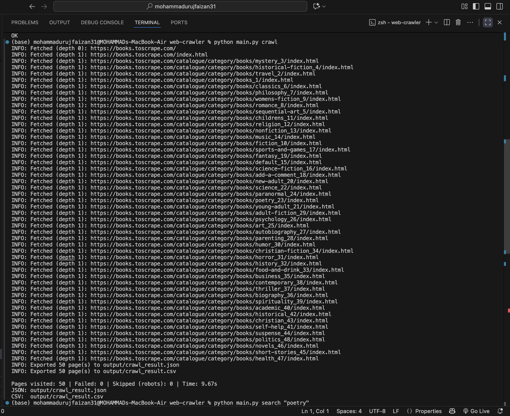
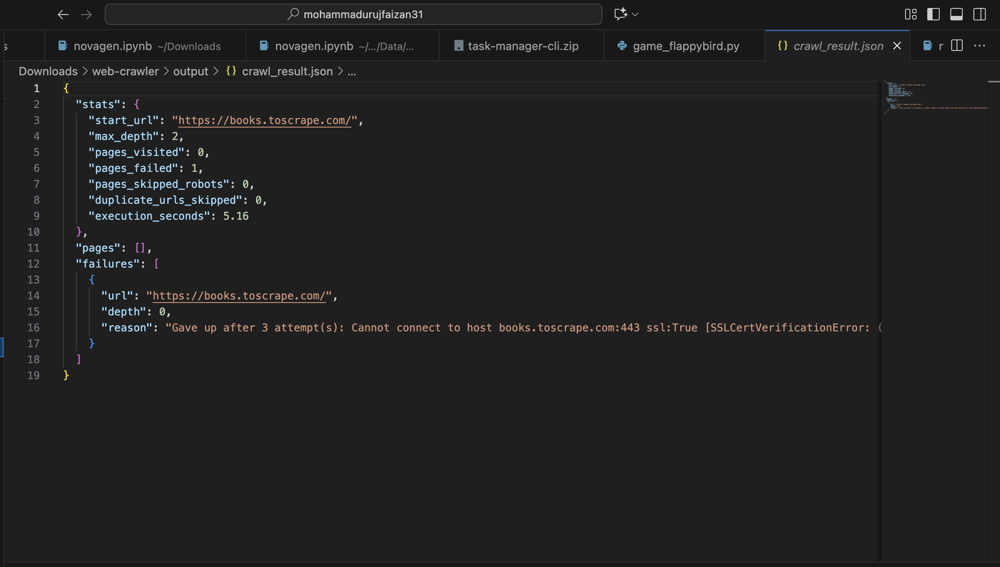

# Web Crawler & Data Extraction Engine

An asynchronous Python web crawler that downloads webpages, extracts structured data, follows internal links up to a configurable depth, and exports the results to JSON and CSV. Built with **asyncio** and **aiohttp** for concurrent fetching, and **BeautifulSoup** for parsing.

## Features

- **Async crawling** with `asyncio` and `aiohttp`, fetching several pages concurrently
- **Depth-limited recursion**, following only internal links (same scheme + host as the seed)
- **Duplicate detection**: every URL is visited at most once, even under concurrency
- **robots.txt support**: fetched once per site and respected by default (`--no-robots` to disable)
- **Retries** with back-off on network errors and non-2xx responses
- Extracts **titles, headings, paragraphs, links, images, and meta description** from every page
- **JSON and CSV export**, plus **crawl statistics** (pages visited, failed, skipped, execution time)
- **Keyword search** and **keyword frequency analysis** over a previous crawl's export
- Configurable via **`.env`**: seed URLs, depth, page limit, concurrency, delay, timeouts, retries
- Logging to console and to `logs/crawler.log`
- 53 automated tests, including a full integration test against a real local server with real link-following and real robots.txt enforcement
- GitHub Actions CI

## Requirements

- Python 3.11+
- See `requirements.txt`

## Installation

```bash
git clone https://github.com/<your-username>/web-crawler.git
cd web-crawler
pip install -r requirements.txt
cp .env.example .env
```

## Usage

Crawl the default seed from `.env`:

```bash
python main.py crawl
```

Crawl specific URLs, overriding settings:

```bash
python main.py crawl https://books.toscrape.com/ --depth 3 --max-pages 100
```

Search a previous crawl's results:

```bash
python main.py search "poetry"
```

Show the most common words across a crawl:

```bash
python main.py keywords --top 15
```

Results are written to `output/crawl_result.json` and `output/crawl_result.csv`.

## Configuration (`.env`)

| Variable | Default | Purpose |
|---|---|---|
| `SEED_URLS` | `https://books.toscrape.com/` | Comma-separated starting URL(s) |
| `MAX_DEPTH` | `2` | How many link-hops to follow from the seed |
| `MAX_PAGES` | `50` | Stop after this many pages |
| `CONCURRENCY` | `5` | Pages fetched at once |
| `DELAY_S` | `0.2` | Pause between batches, to be polite to the server |
| `TIMEOUT_S` | `15` | Per-request timeout |
| `MAX_RETRIES` | `3` | Attempts per page before giving up |
| `RETRY_DELAY_S` | `1` | Base delay between retries (grows each attempt) |
| `RESPECT_ROBOTS` | `true` | Honor robots.txt |
| `USER_AGENT` | `AlgoryxCrawlerBot/1.0 ...` | Sent with every request |
| `OUTPUT_DIR` | `output` | Where JSON/CSV exports are written |
| `LOG_FILE` | `logs/crawler.log` | Log file path |

The default target is [books.toscrape.com](https://books.toscrape.com), a site built specifically for scraping practice. Many real sites forbid automated access in their terms and some actively block bots; always check a site's terms and `robots.txt` before crawling it, which is exactly why this tool respects `robots.txt` by default.

## Project structure

```
web-crawler/
├── main.py                       # Entry point
├── .env.example                  # Settings template
├── webcrawler/
│   ├── cli.py                    # Commands: crawl, search, keywords
│   ├── crawler.py                # Core orchestration: depth, dedup, retries, stats
│   ├── fetcher.py                # Real async HTTP fetching (aiohttp)
│   ├── parser.py                 # HTML -> structured PageData (BeautifulSoup)
│   ├── robots.py                 # robots.txt rules
│   ├── exporter.py               # JSON / CSV export
│   ├── search.py                 # Keyword search and frequency analysis
│   ├── config.py                 # .env settings
│   ├── models.py                 # PageData, CrawlResult, CrawlStats, etc.
│   ├── exceptions.py             # Custom exceptions
│   └── logger_config.py          # Logging setup
├── tests/                        # Unit and integration tests
├── output/                       # JSON/CSV exports land here
└── .github/workflows/tests.yml   # CI
```

## Architecture

**CLI** → **Crawler** (orchestration) → **Fetcher** (network) / **Parser** / **Robots** / **Exporter** / **Search**

The crawler depends only on a small `Fetcher` interface (`fetch`, `fetch_text_or_none`, `close`), not on `aiohttp` directly. This means the entire crawl orchestration, depth limiting, deduplication, retries, robots.txt enforcement, and statistics, is unit tested with a fake in-memory fetcher, and separately verified end-to-end against a real local HTTP server with a real multi-page site and a real `robots.txt`. Only the thin `AiohttpFetcher` class touches `aiohttp` itself.

## Error handling

- A page that fails to load, times out, or returns an error status is retried with back-off, then recorded as a failure. The crawl continues.
- A URL disallowed by `robots.txt` is skipped and counted, never fetched.
- Malformed or missing `robots.txt` is treated as "no rules" rather than failing the crawl.
- Malformed HTML does not crash the parser; it extracts whatever it can.
- Invalid `.env` values (bad URLs, non-numeric settings) stop the run immediately with a clear message.

## Running tests

```bash
python -m unittest discover -v
```

The integration tests spin up a small local web server with a real multi-page site (including a `robots.txt` that disallows one path) and crawl it with the real `Crawler` class, using a `requests`-based fetcher that implements the same interface as the real `aiohttp` one.

## Sample output

See `output/crawl_result.json` and `output/crawl_result.csv` after running `python main.py crawl`.

## Screenshots

**Crawl in progress**


**JSON export**


**Keyword search**


## Author

**<Your Name>** — Python Internship, Algoryx
[LinkedIn](https://linkedin.com/in/<your-profile>) · [GitHub](https://github.com/<your-username>)
